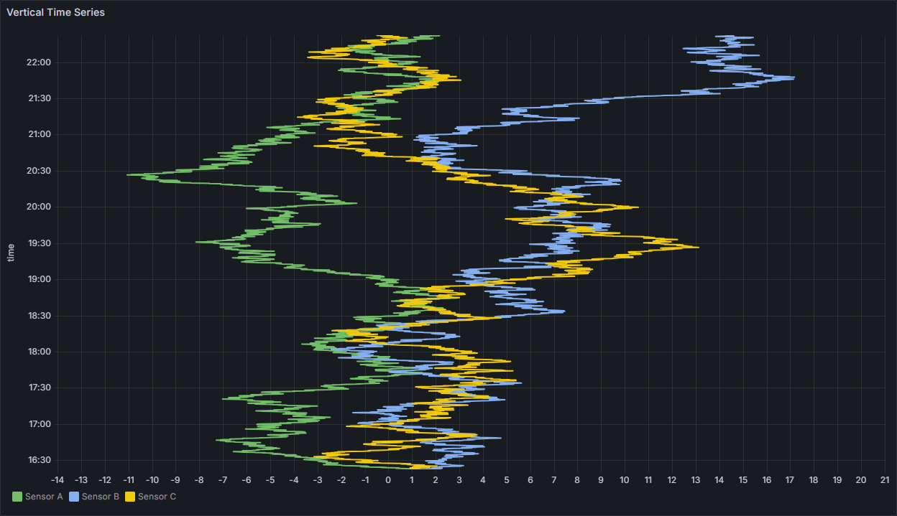

# Vertical Time Series

Grafana panel for multiple metrics on one shared vertical axis (depth, time, or another common reference).

Built from the Grafana XY Chart for the inverted layout (value on X, shared reference on Y). Tooltip and legend keep working for line series; the legend isolates one series at a time.



## Requirements

- Grafana **12.0.0** or later
- Unsigned plugin allow-list until the plugin is signed (`vericode-verticaltimeseries-panel`)

## Getting started

```bash
npm install
npm run build
npm run server
```

Open http://localhost:3000 (admin / admin). Sample dashboards are provisioned automatically.

## Install into an existing Grafana

1. Copy the built `dist` folder to the plugins directory as `vericode-verticaltimeseries-panel`.
2. Allow the plugin id:

```ini
[plugins]
allow_loading_unsigned_plugins = vericode-verticaltimeseries-panel
```

3. Restart Grafana.

## Usage

1. Add a **Vertical Time Series** panel.
2. **Auto** mapping draws every numeric series on the shared vertical axis (time field becomes Y when present).
3. **Manual** mapping: under **Series mapping**, add each series with **Y-Field** (shared reference) and **X-Field** (metric).

## Documentation

- Portuguese guide: [docs/README.md](docs/README.md)

## License

Apache License 2.0. Based on the Grafana XY Chart.
